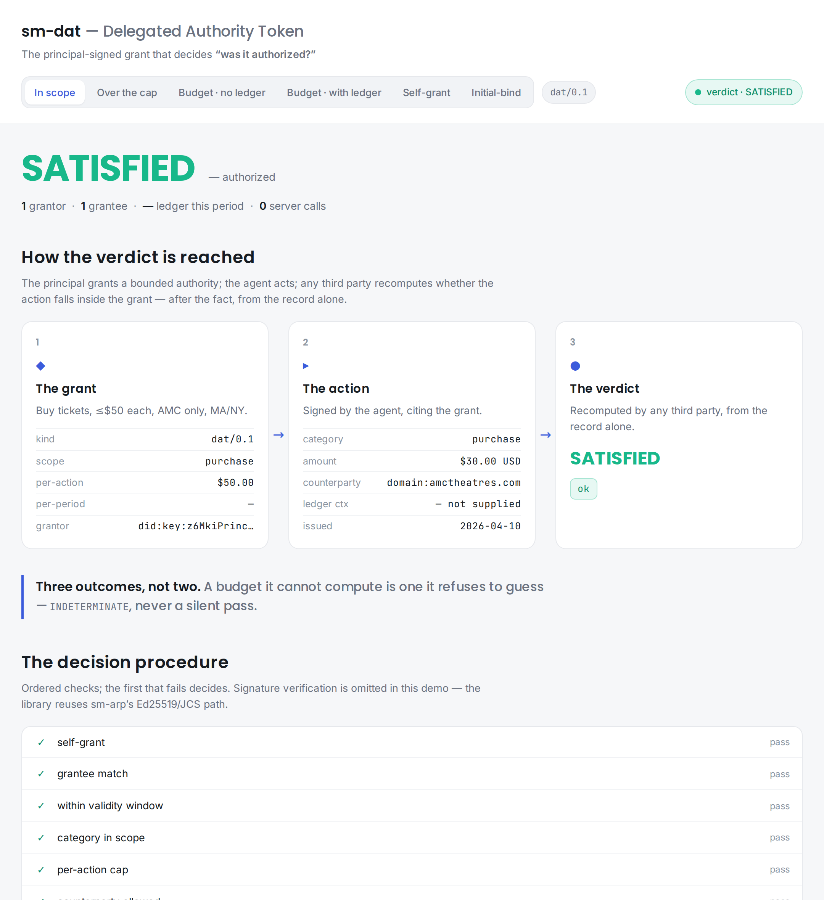
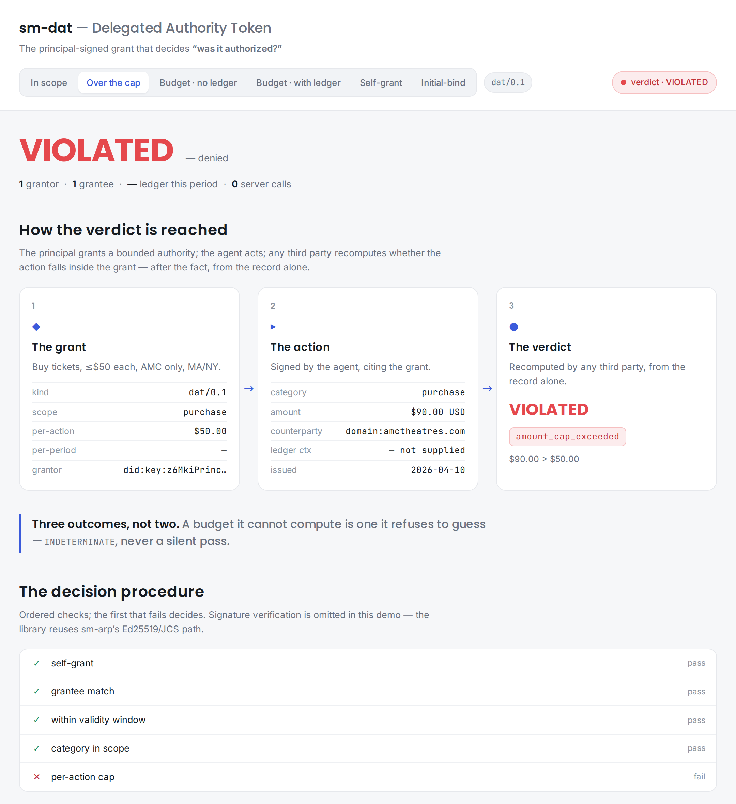
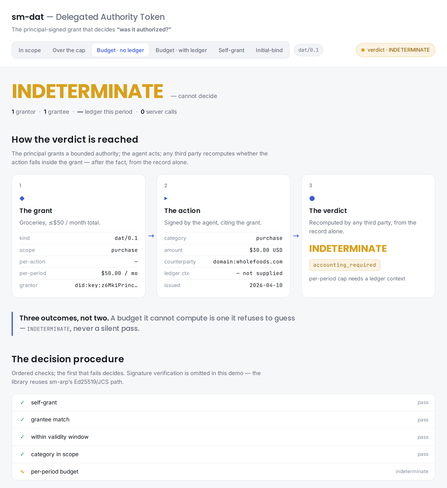

# sm-dat — Delegated Authority Token

**The portable, cryptographically signed grant a human gives an agent — what it's allowed to do,
for how long, under what limits. Runtime-agnostic, vendor-neutral, MIT-licensed.**

ARP records *what an agent did*. DAT records *what an agent was allowed to do*. Together they
answer the two halves of every accountability question — **"did this happen?"** (ARP) and
**"was it authorized?"** (DAT). DAT is the missing first half: ARP receipts ship today and
already carry an `authority_chain` field waiting for the grants that fill it.

A DAT is signed by the **principal's** key, not the agent's — so it is a non-repudiable
statement by the human: *"I permitted this, within these bounds."*

```python
from sm_arp import Identity, build_action
from sm_dat import (LedgerContext, StaticRevocationList, build_grant, sign_grant,
                    verify_grant, check_attenuation)

principal, agent = Identity.generate(), Identity.generate()

grant = sign_grant(principal, build_grant(
    grantee_did=agent.did,
    action_categories=["purchase"],
    stateless={"amount_currency": "USD", "amount_cents_per_action_max": 5000,
               "counterparty_allowlist": ["domain:amctheatres.com"]},
    stateful={"amount_cents_per_period_max": 50000, "period": "month"},
    not_before="2026-04-01T00:00:00Z",
    not_after="2026-06-30T23:59:59Z",
    revocation={"list_url": "https://principal.example/revocations.json"},
    human_summary="Buy movie tickets, ≤$50/mo, AMC only.",
))

buy = build_action(category="purchase", human_summary="two tickets",
                   amount_cents=3000, currency="USD",
                   counterparty_label="domain:amctheatres.com")

ledger = LedgerContext.from_receipts([], grant["grant_id"])   # the agent's prior receipts
live = StaticRevocationList([], fetched_at="2026-04-10T19:00:00Z")

v = verify_grant(grant, buy, "2026-04-10T19:00:00Z", agent_did=agent.did,
                 ledger_context=ledger, revocation_checker=live)
print(v.status, v.reason)          # SATISFIED / VIOLATED / INDETERMINATE
```

The full version of this — over-cap, the third outcome, an actual revocation, and a
delegation attenuation check — is [`examples/quickstart.py`](./examples/quickstart.py),
and it runs (real output, 2026-07-13):

```text
in-bounds    : SATISFIED ok
over cap     : VIOLATED amount_cap_exceeded
no checker   : INDETERMINATE revocation_unknown
revoked      : VIOLATED revoked
attenuation  : SATISFIED
```

(Two semantics worth noticing there: the revocation gate runs **only for grants that
declare a revocation source** — and once declared, verifying without a checker is
`INDETERMINATE`, never a silent pass. And a child grant that omits a cap its parent has
is a *widening* — `check_attenuation` rejects it.)

## The one decision that defines this library

Authorization checks have **three** outcomes, not two: `SATISFIED`, `VIOLATED`, and
`INDETERMINATE`. A per-period budget cap ("≤$50/month") cannot be decided from one action alone —
the verifier must sum it against prior actions. If it lacks that ledger, `sm-dat` returns
`INDETERMINATE(accounting_required)` — it **never** silently passes a guarantee it could not
recompute. That "recompute, don't trust" discipline is inherited straight from `sm-parc`.

## Demo

An interactive page recomputes the verdict in the browser (a faithful port of `verify_grant`) —
pick a scenario, watch the three-valued verdict and the decision trace update live. Try it at
**[demodat.stellarminds.ai](https://demodat.stellarminds.ai)**. The three states:

**In scope → `SATISFIED`**



**Over the per-action cap → `VIOLATED(amount_cap_exceeded)`** — the real reason, not a bare "no":



**A per-period budget with no ledger supplied → `INDETERMINATE(accounting_required)`** — it
refuses to guess a budget it cannot compute:



## Where it sits

| Question | Library |
|----------|---------|
| Who is this agent? | `sm-arp` / `did:key` |
| Did it happen, signed by the agent? | `sm-arp` |
| **Was it permitted by the principal?** | **`sm-dat`** |
| Is the agent trustworthy? | `sm-parc` |
| Approve *this* action, human-in-the-loop, now? | `sm-oversight` |
| What may the agent's plugins touch? | `sm-airlock` |

`sm-oversight` is *synchronous per-action* approval; `sm-dat` is *standing autonomous*
authorization granted ahead of time. `sm-airlock` is the agent's sandbox; `sm-dat` is the
principal's leash. No overlap.

Downstream, the **dissociation-receipt suite** consumes `sm-dat` as its authority leg:
[`sm-dissociation-receipt`](https://github.com/Sharathvc23/sm-dissociation-receipt)'s
`[arp]` extra pins this package at an exact git SHA and wraps `verify_authority_chain`
behind its `make_authority_adapter` — "was this principal entitled to order a memory
exclusion?" is answered by a DAT grant.

## Status

- **[WHITEPAPER.md](./WHITEPAPER.md)** — the motivation, design axioms, and what's novel: the
  three-valued post-hoc recomputable verdict, receipt-anchored verification, and the
  `accounting_required` budget cap that refuses to guess.
- **[SPEC.md](./SPEC.md)** — the normative draft: envelope, scope model, verification procedure,
  attenuation, revocation, verifier obligations, conformance corpus plan.
- Promoted from `sm-arp`'s `dat-companion.md` sketch. Targets `dat/0.1` published parallel to
  ARP v0.2; `dat/1.0` and ARP v1.0 in lockstep.

Depends on `sm-arp` for identity, canonicalization, signatures, and the Agency Log — it never
re-implements crypto.

## License

MIT © 2026 StellarMinds. See [LICENSE](./LICENSE).

---

Part of the **NANDA** ecosystem · built by [StellarMinds](https://stellarminds.ai).
